<p align="center">
  <a href="docs/pitch/Drawproof-Pitch.pdf">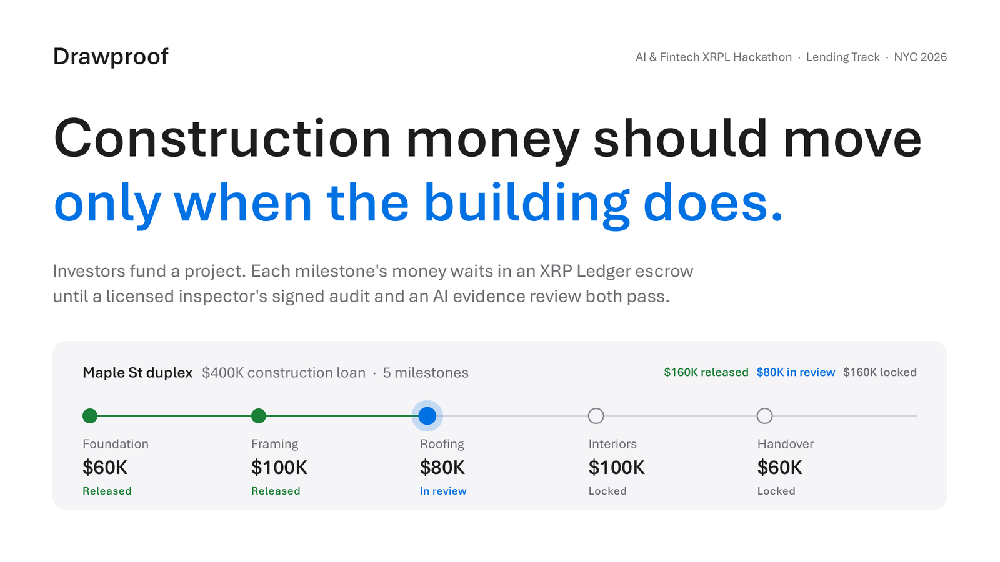</a>
</p>

<h1 align="center">Drawproof</h1>

<p align="center"><strong>Construction money that moves only when the building does.</strong></p>

<p align="center">
  <a href="https://github.com/Jalil-g/XRLP-Hack/actions/workflows/ci.yml"></a>
  
  
  
  
  
</p>

<p align="center">
  <a href="docs/pitch/Drawproof-Pitch.pdf">Pitch deck</a> ·
  <a href="https://github.com/Jalil-g/XRLP-Hack/releases/tag/submission-2026-10-25">Demo video</a> ·
  <a href="docs/submission/README.md">Submission page</a> ·
  <a href="docs/submission/xrpl-primitives.md">Every XRPL primitive, with devnet proof</a> ·
  <a href="docs/05-api.md">API</a> ·
  <a href="docs/submission/what-we-dont-claim.md">What we don't claim</a>
</p>

A construction-lending marketplace on the XRP Ledger, built like a release pipeline for construction draws. Investors pool RLUSD into a
native XRPL Vault per project. The Lending Protocol lends to a project account no single party controls. Each milestone's money sits in
its own escrow that can only pay **this builder** or go back, and it is released only when the milestone's **test suite** is green: a
licensed inspector's signed site audit plus the AI's checks over the builder's evidence. One red check, and the money stays locked, with
the failing check visible to everyone.

Built in 36 hours for the AI & Fintech XRPL Hackathon NYC (Oct 24–25, 2026), Lending & Borrowing track. **Devnet prototype, not an offer
to invest.**

## 90-second tour

<p align="center">
  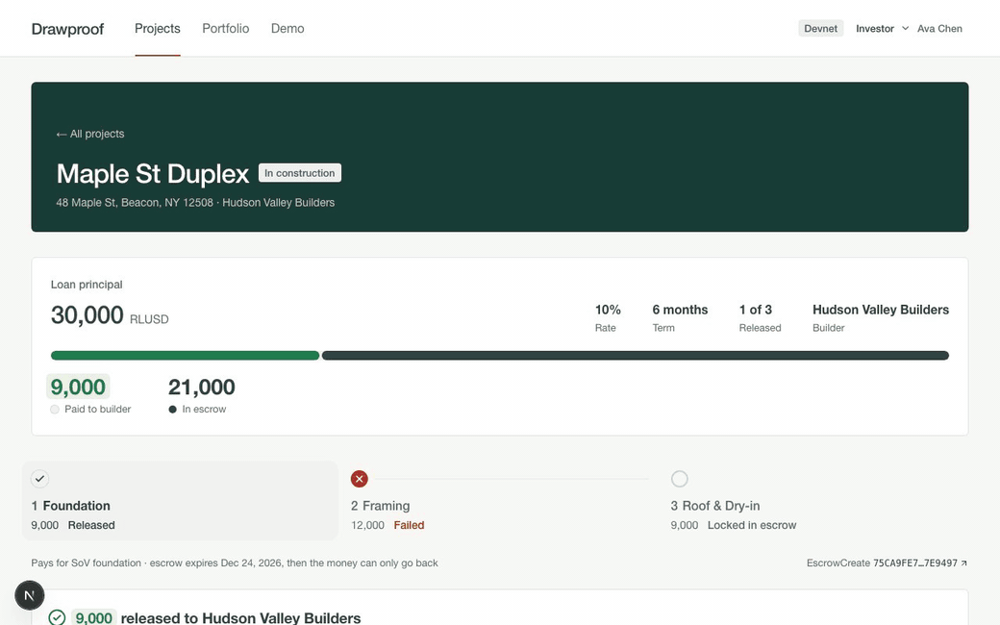
</p>

The investor opens the Maple St duplex. Foundation passed all ten checks and 9,000 RLUSD went to the builder. Framing failed one check
(the inspector marked a Schedule of Values line not done) and 12,000 RLUSD stays locked. Then the inspector's view of the same milestone.
Recorded against the real apps on XRPL devnet with the AI checks in mock mode (labelled on screen).

## Screenshots

Taken from the running apps on devnet, Oct 25, 2026. Every hash on screen is a real devnet transaction.

<table>
  <tr>
    <td width="50%" valign="top">
      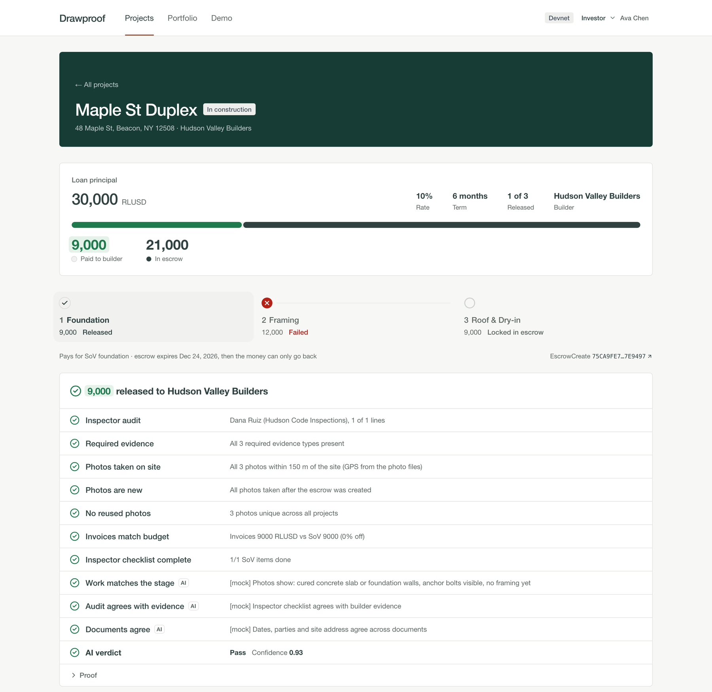
      <p align="center"><sub><strong>Milestone released.</strong> Seven deterministic checks, three AI checks, the signed audit, then <code>EscrowFinish</code>.</sub></p>
    </td>
    <td width="50%" valign="top">
      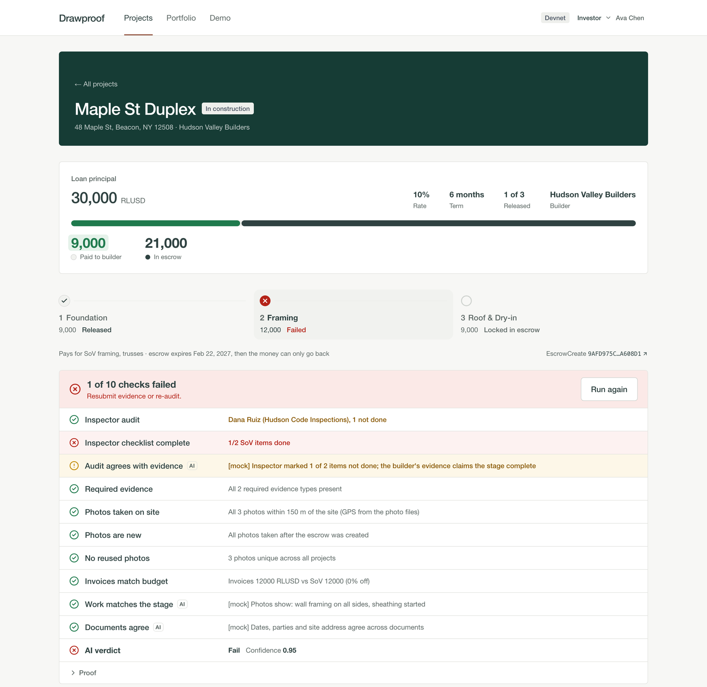
      <p align="center"><sub><strong>Milestone held.</strong> One red check keeps 12,000 RLUSD in escrow, and everyone sees which one.</sub></p>
    </td>
  </tr>
  <tr>
    <td valign="top">
      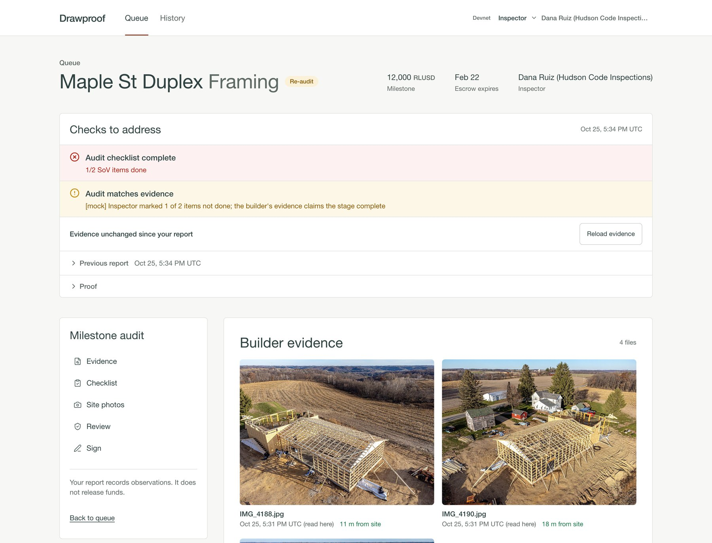
      <p align="center"><sub><strong>Inspector audit.</strong> Builder evidence, photo locations against the site, a checklist per Schedule of Values line, signed in the browser.</sub></p>
    </td>
    <td valign="top">
      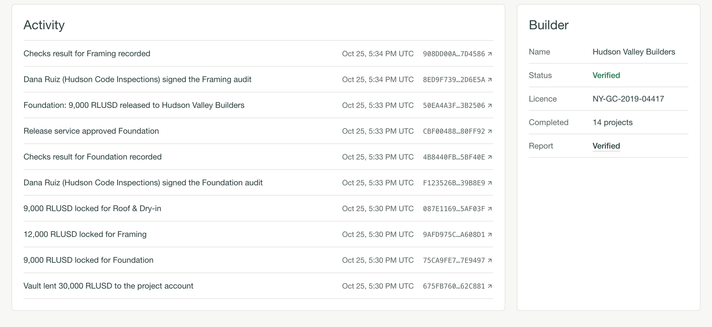
      <p align="center"><sub><strong>Receipts.</strong> Audit signed, checks recorded, release attested, escrow finished. Each line links to the explorer.</sub></p>
    </td>
  </tr>
  <tr>
    <td valign="top">
      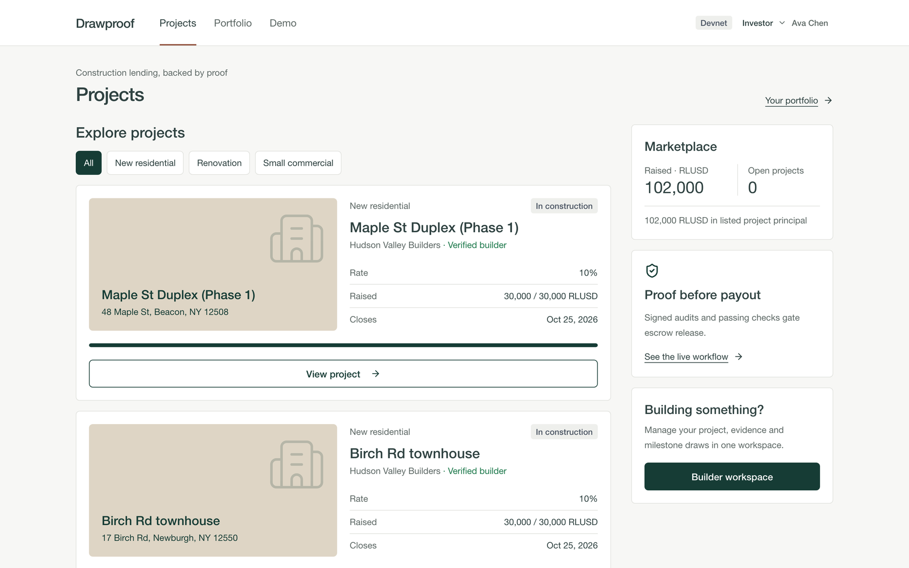
      <p align="center"><sub><strong>Marketplace.</strong> Verified projects, each with its own vault.</sub></p>
    </td>
    <td valign="top">
      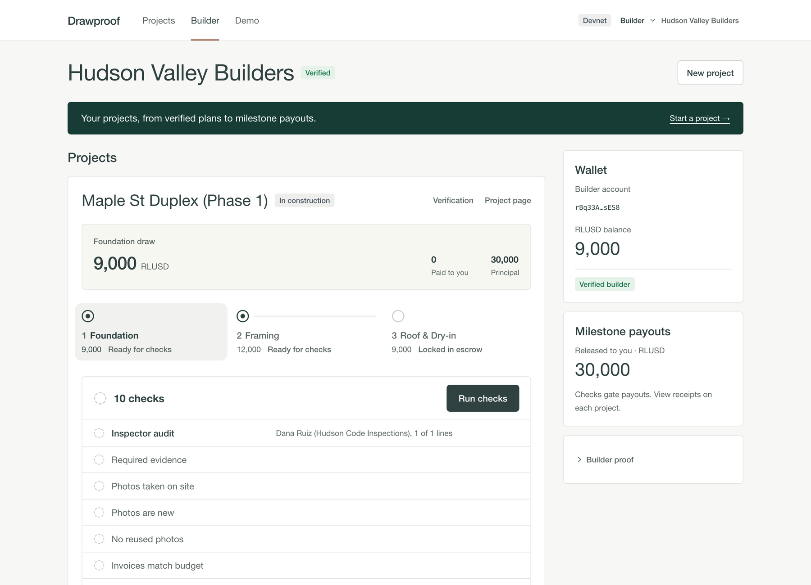
      <p align="center"><sub><strong>Builder workspace.</strong> Upload evidence per draw, watch the checks, get paid.</sub></p>
    </td>
  </tr>
  <tr>
    <td valign="top">
      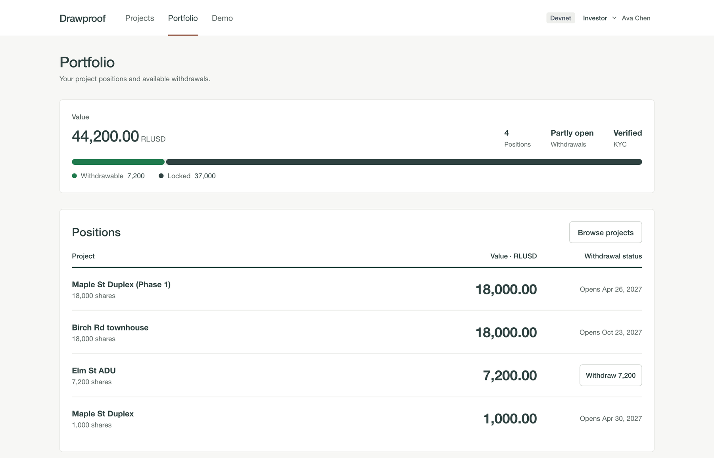
      <p align="center"><sub><strong>Investor portfolio.</strong> Vault shares per project, withdrawals open at the vault's redemption date.</sub></p>
    </td>
    <td valign="top">
      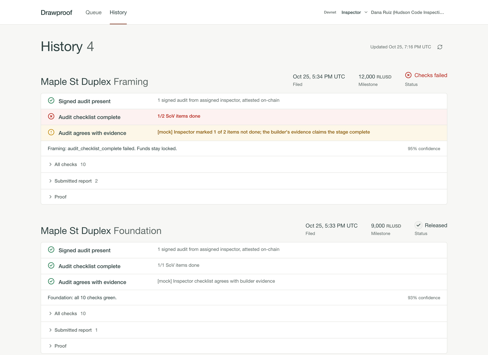
      <p align="center"><sub><strong>Inspector history.</strong> Every filed audit and what the suite made of it.</sub></p>
    </td>
  </tr>
  <tr>
    <td valign="top">
      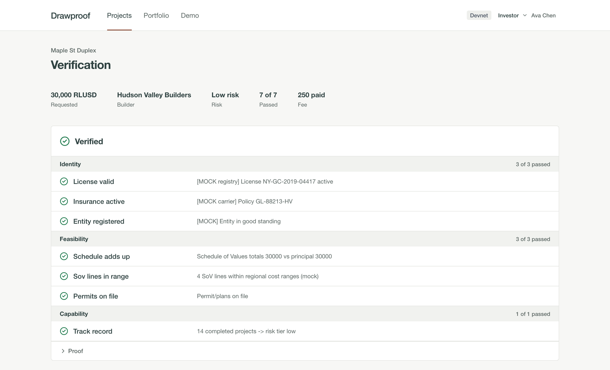
      <p align="center"><sub><strong>Project verification.</strong> Identity, feasibility, capability. Pass, and the builder gets a <code>VERIFIED_BUILDER</code> credential.</sub></p>
    </td>
    <td valign="top">
      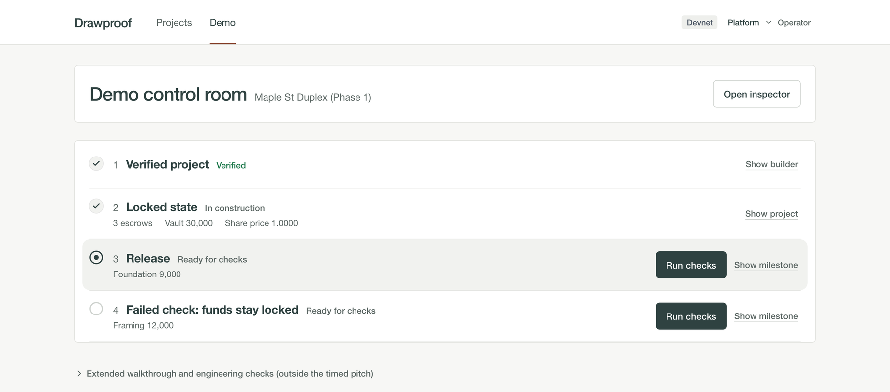
      <p align="center"><sub><strong>Demo control room.</strong> The four scenes of the pitch, each with its one action and live state.</sub></p>
      <br>
      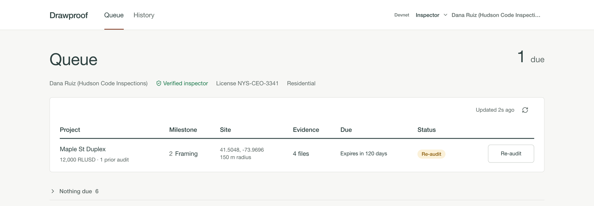
      <p align="center"><sub><strong>Inspector queue.</strong> Assigned by the platform, not chosen by the builder.</sub></p>
    </td>
  </tr>
</table>

## How it works

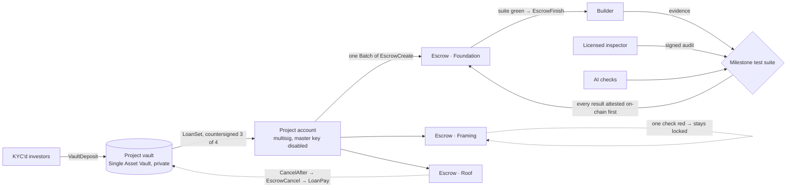

Every milestone has a test suite, like CI for a construction draw. Deterministic checks: required evidence present, photos geotagged on
site, photos fresh, no photo reused across projects (perceptual hash), invoices match the Schedule of Values line, a signed audit from the
assigned inspector attested on-chain, checklist complete. Judgement checks with Claude: work matches the stage, audit agrees with the
evidence, documents agree. All required checks green, the escrow releases in seconds. One red, the money stays locked. Low confidence
goes to a named operator who decides with a signed, on-chain reason.

| Guarantee | Who enforces it |
|---|---|
| A milestone escrow can only pay **this builder**, or return to the project account after `CancelAfter`. Nobody can redirect it, us included. | **Ledger**: Token Escrow, destination fixed at creation, mandatory `CancelAfter` |
| The project account needs **3 of 4** signers (platform, builder, inspector, trustee) and holds ≈ 0 liquid RLUSD by design. | **Ledger**: SignerList quorum 3, master key disabled |
| Only `KYC_INVESTOR` holders can deposit. Listed builders hold `VERIFIED_BUILDER`, inspectors `VERIFIED_INSPECTOR`. | **Ledger**: Credentials + Permissioned Domain on a private vault |
| Money is released **only after the suite is green**, with every check result attested on-chain before the finish. | **Our release service** (holds the preimages, disclosed). On-chain enforcement needs Smart Escrows (XLS-100): roadmap |

The honest version: the ledger enforces *where* the money can go and *when it expires*. *When it is released* is decided by our published
suite, attested on-chain before the `EscrowFinish`, so anyone can check afterwards that money moved only after the suite went green. If
the release service were compromised, the worst case is an early release to the correct builder, never a redirection.
More in [what we don't claim](docs/submission/what-we-dont-claim.md).

## See it on devnet

| What happened | Transaction |
|---|---|
| The vault lends to the project account, countersigned by 3 of its 4 signers | [LoanSet](https://devnet.xrpl.org/transactions/CB2FC8BC3E359DE2CB32DD37D81440B0DD2674E19123552F23884E89B9E0694E) |
| Milestone 1 locked in its own escrow, payable only to the builder | [EscrowCreate](https://devnet.xrpl.org/transactions/191E0B3E5E2A3B644F9F679B9087CA785AA218DFE26E886901E7BF217C975254) |
| Milestone 1 released: 9,000 RLUSD to the builder | [EscrowFinish](https://devnet.xrpl.org/transactions/AEBAE654EE00A0F1B88F19B44BAED9B02B4465311B70428B3B33DC2D2A787B75) |
| A finish with the wrong fulfillment | [`tecCRYPTOCONDITION_ERROR`](https://devnet.xrpl.org/transactions/61E13CB3CE9297886E7A46C784951B9D1E5BD75335C0D026A3FA47673C22A2B5) |
| An investor without KYC tries to deposit | [`tecNO_AUTH`](https://devnet.xrpl.org/transactions/6D17631BB609C7716C145A5F37EB4179D6E75730E9D2C7BA875E31F0505D45DE) |
| Stall: the expired escrow goes back, the project account repays the vault | [EscrowCancel](https://devnet.xrpl.org/transactions/3BD1B494EEAC9A897879434E7657C95C8F19C485053D825F44E5E59E9F0F5AF0) · [LoanPay](https://devnet.xrpl.org/transactions/686028E03383EC8AC3DE4CEF02B087822EA06D1EF34E6A7906E974C247EA4B25) |
| The inspector's audit, signed offline, attested on-chain | [attestation](https://devnet.xrpl.org/transactions/027F4FE6972AC8C2203E3C44E80E9FEA5E2D785B5AB81CD0CB70C7BE5D516CD3) |

Full runs with every transaction: [devnet proof (Oct 25)](docs/proof-devnet-2026-10-25-v2.md) ·
[XRPL primitives, code + proof](docs/submission/xrpl-primitives.md).
XRPL features used: Single Asset Vault (XLS-65), Lending Protocol (XLS-66), Token Escrow (XLS-85), Batch (XLS-56), Credentials,
Permissioned Domains, multisig SignerLists, memo attestations.

## Pitch deck

Six slides, three minutes. [PDF](docs/pitch/Drawproof-Pitch.pdf) · [PPTX](docs/pitch/Drawproof-Pitch.pptx) ·
[storyline](docs/08-pitch-storyline.md) · generated from [`docs/pitch/build-deck.cjs`](docs/pitch/build-deck.cjs).

<table>
  <tr>
    <td><a href="docs/pitch/Drawproof-Pitch.pdf"></a></td>
    <td><a href="docs/pitch/Drawproof-Pitch.pdf">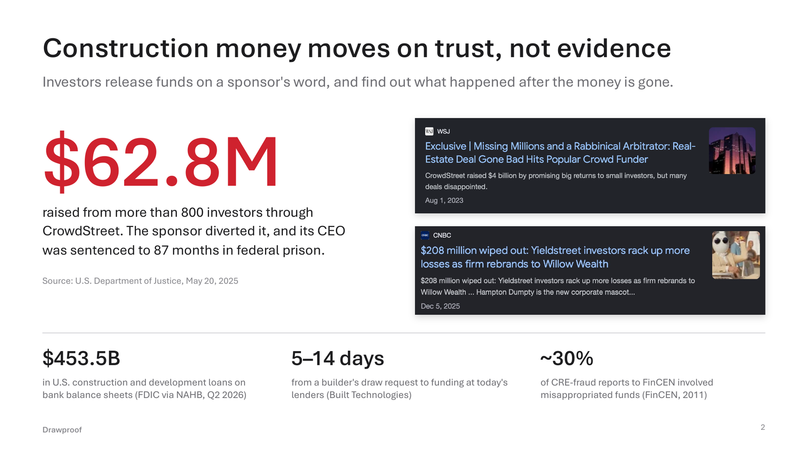</a></td>
    <td><a href="docs/pitch/Drawproof-Pitch.pdf">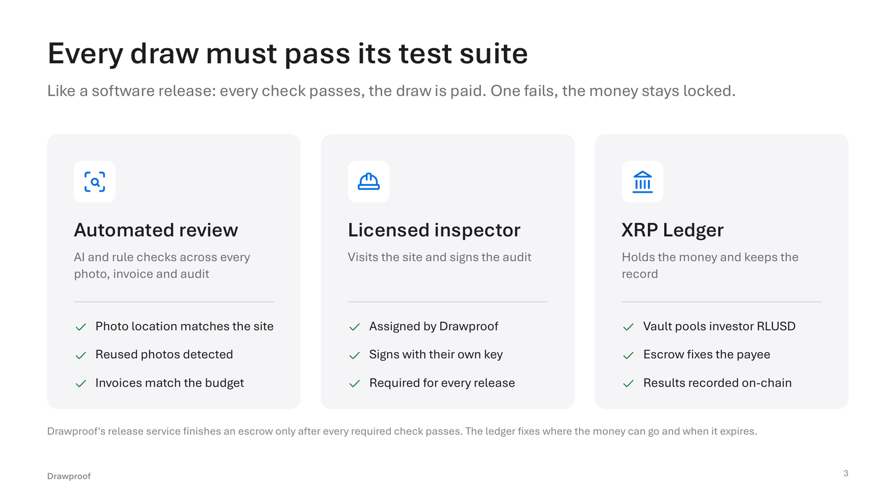</a></td>
  </tr>
  <tr>
    <td><a href="docs/pitch/Drawproof-Pitch.pdf">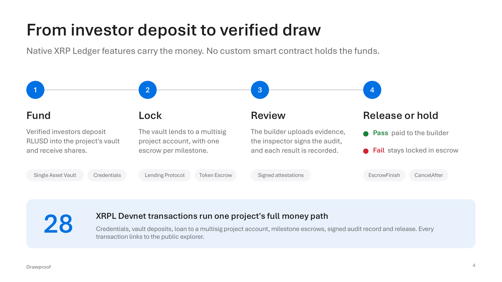</a></td>
    <td><a href="docs/pitch/Drawproof-Pitch.pdf">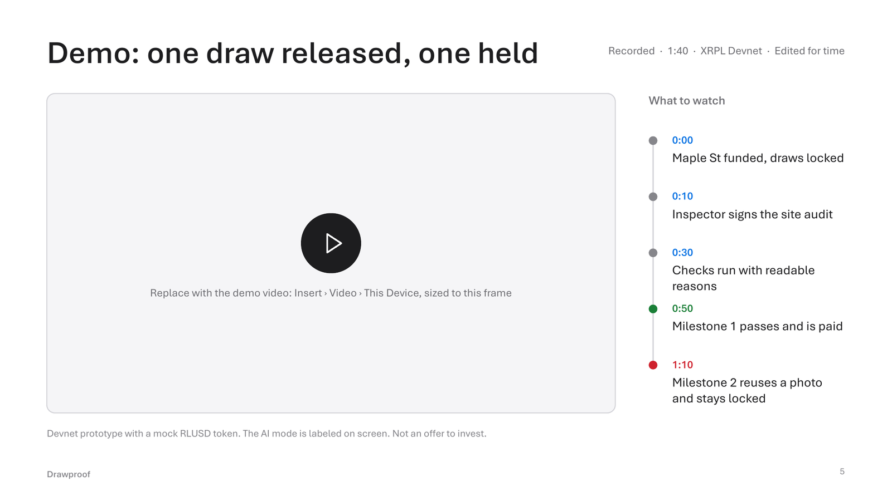</a></td>
    <td><a href="docs/pitch/Drawproof-Pitch.pdf">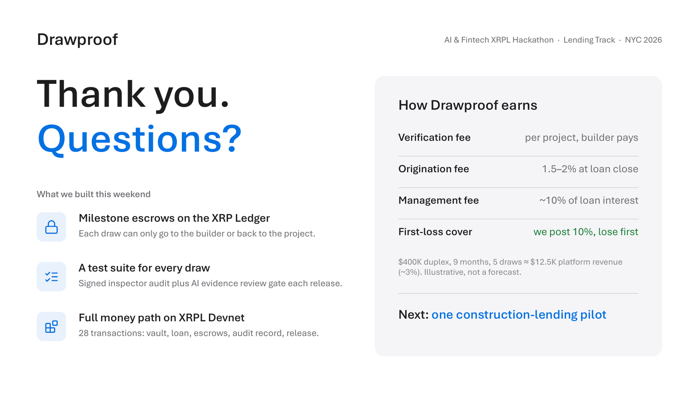</a></td>
  </tr>
</table>

## Run it locally

Node ≥ 22 (we use 24) and pnpm 10.

```bash
git clone https://github.com/Jalil-g/XRLP-Hack && cd XRLP-Hack
pnpm install
cp .env.example .env                    # fake ledger + mock verifier by default; .env is gitignored
```

Three processes, one terminal each:

```bash
pnpm --filter @xrlp/core serve                                                              # :4000 core API (LEDGER_MODE=fake)
NEXT_PUBLIC_API_MODE=http CORE_URL=http://localhost:4000 pnpm --filter @xrlp/web dev        # :3000 website
NEXT_PUBLIC_API_MODE=http CORE_URL=http://localhost:4000 pnpm --filter @xrlp/inspector dev  # :3001 inspector app
```

Load the Maple St demo data (also resets it):

```bash
curl -X POST localhost:4000/api/admin/demo/reset -H 'content-type: application/json' -d '{"seed":"maple-st"}'
```

| URL | What |
|---|---|
| http://localhost:3000 | Website: verified projects, project page with the checks panel, invest, portfolio, builder workspace, `/demo` control room. Switch Investor / Builder / Platform in the account menu (top right). |
| http://localhost:3001 | Inspector app: assigned audits, audit form (checklist per Schedule of Values line, geotagged photos), signed submission, history, pre-construction site visit. |
| http://localhost:4000 | Core HTTP API (routes in [`docs/05-api.md`](docs/05-api.md)). Both apps proxy `/api/*` to it. |

**Modes.**
- `LEDGER_MODE=fake` (default): no keys, no network. Transaction hashes are not real, even where shown as explorer links.
- `LEDGER_MODE=devnet`: real devnet transactions. Run `pnpm --filter @xrlp/xrpl bootstrap` first (faucet-funded roles into
  `.data/wallets.json`, gitignored); core refuses to start without it. To sign audits in the browser, paste the inspector's devnet seed
  into the inspector app ("Load your inspector key"); it stays in that browser.
- `NEXT_PUBLIC_API_MODE=mock`: either app on its own, on built-in fixtures, no core needed.
- `VERIFIER_MODE=live` + `ANTHROPIC_API_KEY`: the AI checks call Claude instead of the deterministic mock.

All variables, with defaults: [`.env.example`](.env.example). Demo runbook: [`docs/04-demo-script.md`](docs/04-demo-script.md).

## Test

```bash
pnpm -r typecheck
pnpm -r test                                  # every package; no network, no keys
pnpm --filter @xrlp/core simulate             # the whole story on FakeLedger + FakeVerifier, prints the timeline
pnpm --filter @xrlp/inspector test:e2e        # inspector app -> running core (-> devnet with INSPECTOR_SEED). Resets core's demo data.
pnpm --filter @xrlp/xrpl demo                 # full money path on devnet (~6 min), every tx with its explorer link
```

More devnet scripts (compliance, escrow and multisig spikes, batch, default): [submission page](docs/submission/README.md#how-to-run).

## Repo

| Path | What | Owner |
|---|---|---|
| `apps/web` | Investor / builder website and `/demo` control room | [@bri-yin](https://github.com/bri-yin) |
| `apps/inspector` | Inspector app: queue, audit form, signed audits, history, site visits | [@RoroDev2023](https://github.com/RoroDev2023) |
| `packages/core` | Orchestrator, HTTP API, release service (escrow preimages), keeper | [@seanpatrickmay](https://github.com/seanpatrickmay) |
| `packages/xrpl` | Every ledger operation, devnet scripts and proofs, the `LedgerPort` adapter | [@Jalil-g](https://github.com/Jalil-g) |
| `packages/verifier` | Project verification and the milestone test suite (mock + Claude) | [@elmir132](https://github.com/elmir132) |
| `packages/attest-signer` | Inspector software key and audit attestations (signed in the browser) | [@RoroDev2023](https://github.com/RoroDev2023) |
| `packages/shared` | The contract: types, states, ports | [@seanpatrickmay](https://github.com/seanpatrickmay) |
| `design/drawproof-ui` | Clickable design preview on mock data, plus the demo recorder | [@elmir132](https://github.com/elmir132) |
| `docs/` | Overview, product, architecture, API, demo script, decisions, pitch, submission | everyone |

Read in order: [overview](docs/00-overview.md) → [decisions](docs/decisions.md) → [product](docs/02-product.md) →
[architecture](docs/03-architecture.md) → [API](docs/05-api.md). Contributing (lanes, branch rules, handoffs): [`AGENTS.md`](AGENTS.md).

Built with TypeScript, xrpl.js 5.3.0, Next.js, Hono, and Claude through the Anthropic SDK.
